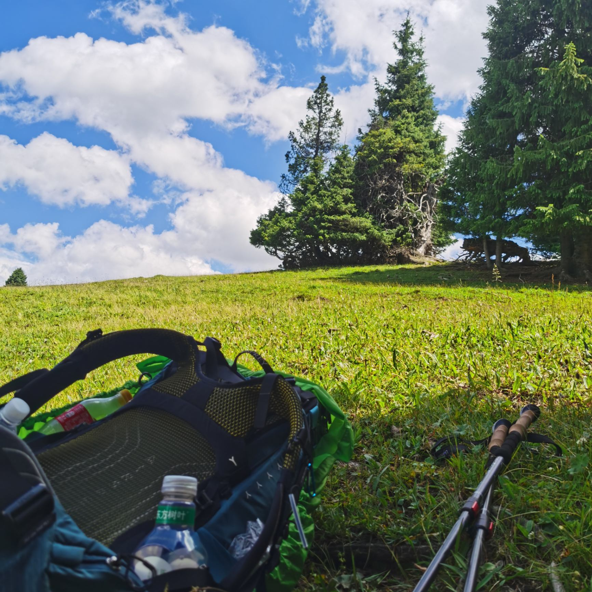

### Hi, I'm Leo 👋

写代码，也写点字。喜欢把模糊的理解整理成清晰的东西。

- 🔭 目前在做：折腾各种 AI 工具链和自动化
- ✍️ 博客：[navigatorxia.github.io](https://navigatorxia.github.io) — 技术笔记与踩坑记录
- 💬 聊聊：后端、AI Agent、工程效率

---

#### 常用

#### 最近

<!-- 可以在这里放置顶项目、正在读的书、最近写的文章 -->

- 🆕 [从零到上线：我的博客是怎么搭起来的](https://navigatorxia.github.io/2026/11/02/blog-building-notes/)

---

把学过的东西写出来，才算真的学会。
